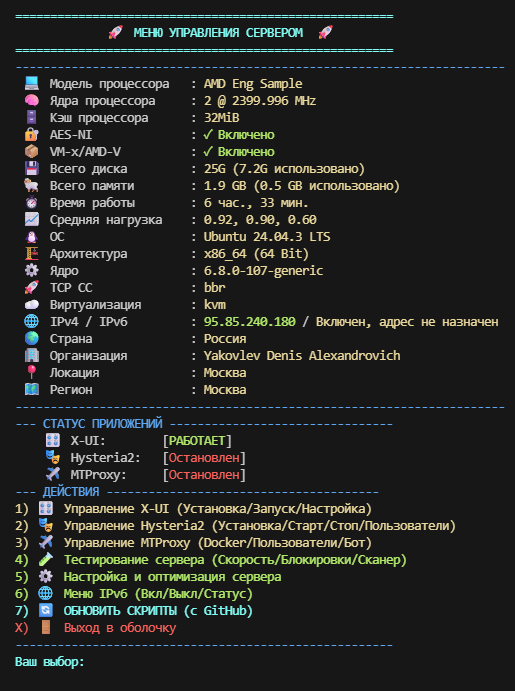
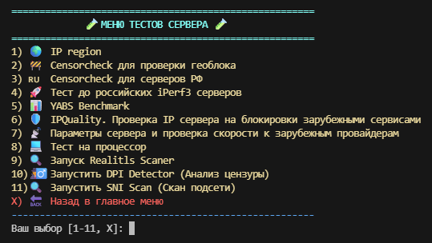
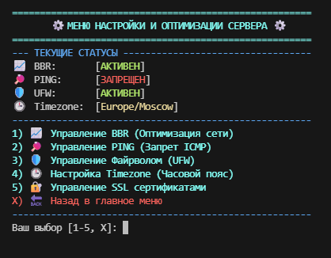

# 🚀 VPS Server Menu

**VPS Server Menu** — это мощный, удобный и полностью интерактивный Bash-скрипт для быстрого управления и настройки вашего VPS/VDS сервера. 

Забудьте о необходимости запоминать десятки длинных команд. Управляйте прокси, сетью, фаерволом и системными тестами прямо из красивого консольного меню!

---

## ✨ Главные возможности

* 📊 **Системный мониторинг:** Отображение нагрузки на процессор (LA), использования оперативной памяти и аптайма сервера прямо на главном экране.
* 🛡️ **Управление прокси:** Установка, настройка и управление современными протоколами обхода блокировок:
  * **Hysteria2** (с автоматической генерацией сертификатов и управления пользователями).
  * **X-UI** (VLESS, Reality, Trojan и др.).
* 🌐 **Управление сетью и IPv6:** Безопасное включение/отключение IPv6 на уровне ядра, проверка доступности и назначенных адресов.
* ☁️ **Cloudflare WARP:** Управление официальным WARP-клиентом (SOCKS5), **Endpoint Manager / WARPSCOUT** с подбором endpoint, проверкой трафика и откатом, а также Advanced WARPSCOUT для AmneziaWG.
* 🔒 **Фаервол и порты:** Быстрое открытие портов (UFW) и управление SSL-сертификатами (Acme.sh).
* 🧪 **Инструменты тестирования (Menu Tests):** Встроенные скрипты для диагностики сети и обхода блокировок:
* 🔄 **Умное обновление:** Встроенная функция `git pull` для обновления меню до последней версии в один клик без перезагрузки сервера.
## 🛠 Установка / Обновление
Запустите команду в терминале вашего сервера:
```bash
bash <(curl -sL https://raw.githubusercontent.com/Diman6267/VPS-Server-Menu/main/install.sh)
```

## 🗑 Удаление
```bash
bash <(curl -sL https://raw.githubusercontent.com/Diman6267/VPS-Server-Menu/main/uninstall.sh)
```
---
## 📸 Скриншоты









## ⚙️ Требования
ОС: Ubuntu 20.04+

Права: root

Установленные пакеты: git, curl (остальные зависимости, такие как Docker или Python, меню установит автоматически при запуске соответствующих тестов).

## 🎯 WARP для 3x-ui / Xray

Меню устанавливает **официальный Cloudflare WARP в SOCKS5 proxy mode**. По умолчанию proxy доступен на `127.0.0.1:40000`; Xray может направлять через него выбранный трафик:

```text
3x-ui / Xray
    ↓ SOCKS5
127.0.0.1:40000
    ↓
Official Cloudflare WARP
    ↓
Internet
```

Откройте **Настройка и оптимизация сервера → Cloudflare WARP** и установите WARP (пункт 1). Затем откройте **7) Endpoint Manager / WARPSCOUT**:

1. **Найти самый быстрый endpoint** — рекомендуемый режим, использует download throughput ranking WARPSCOUT (`-best-by speed`).
2. **Минимальная задержка / стабильность** — выбирает по потерям пакетов и ping внутри туннеля (`-P -best`).
3. **Задать вручную** — `IPv4:PORT` или `[IPv6]:PORT`.
4. **Вернуть Cloudflare AUTO** — убрать закреплённый endpoint.
5. **Проверить здоровье WARP** — проверить реальный SOCKS5 data path.
6. **Показать outbound для 3x-ui / Xray** — получить JSON с текущим SOCKS5 портом и явным `users: []`. Добавьте outbound в Xray/3x-ui и направьте нужные routing rules на tag `warp-outbound` самостоятельно.
7. **Advanced WARPSCOUT / AmneziaWG** — отдельные инструменты для standalone AWG.

Если WARPSCOUT или его account ещё отсутствуют, поиск предложит установить/создать их. После scan меню показывает выбранный endpoint, измеренные speed/ping/loss, применяет его к official WARP и проверяет SOCKS5. После успеха выводятся HEALTHY, exit IP, colo и location. При ошибке команды, проверок, Ctrl+C или обрыве SSH во время применения восстанавливаются прежние endpoint/AUTO, протокол, порт и состояние подключения; повторный сигнал не прерывает rollback, а его результат проверяется повторно. Установка, изменение endpoint/порта и пункт start/stop сериализуются lock-файлом `/run/lock/vps-server-menu-warp.lock`: параллельная операция из другого меню или CLI сразу завершается отказом без изменений.

**«Самый быстрый» означает лучший среди кандидатов speed phase.** WARPSCOUT сначала отбирает перспективные endpoint, затем последовательно измеряет throughput части из них, а не каждого IP огромного Cloudflare pool. Отсутствующие метрики показываются как недоступные; это не мешает проверке найденного endpoint. Метрики кандидата измеряет WARPSCOUT, а работоспособность production SOCKS5 отдельно подтверждает official WARP. Сопоставимое «до → после» меню не измеряет.

### Health и ограничения

- **HEALTHY:** active `warp-svc`, Connected, proxy mode, loopback listener и HTTPS Cloudflare trace через `socks5h://127.0.0.1:PORT` с `warp=on` (или `warp=plus` для WARP+). **DOWN:** служба/туннель отключены или listener отсутствует. **DEGRADED:** data path или состояние не подтверждены. Экран WARP menu и Endpoint Manager при каждой перерисовке выполняет тот же health check, поэтому при неработающем туннеле перерисовка может занять до нескольких секунд; генерация Xray JSON читает только локальные настройки.
- Проверено на Ubuntu 24.04 x86_64, official WARP `2026.8.2110.0`, WARPSCOUT `0.16.0`. В этом proxy mode работает **MASQUE/QUIC**: WireGuard daemon отклоняет, HTTP/2 option не меняет фактический UDP transport. Transport отображается как состояние, выбора неподдерживаемых протоколов нет.
- Поиск требует подтверждённых MASQUE/QUIC и SNI из `tunnel stats`. Номер версии не является запретом: проверяются JSON schema и CLI capabilities. Отсутствие endpoint override считается AUTO только при известной структуре `settings`/`sources`; неизвестный контракт означает **UNKNOWN**, и изменения блокируются для безопасного rollback.
- MASQUE использует anycast pools; смена Cloudflare node не гарантируется, node/country filters для него upstream не поддерживает. AWG результаты не применяются к official WARP.
- Закреплённый endpoint и настройки proxy сохраняет сам `warp-svc`, включая restart. При внешней сетевой аварии здоровье после rollback также может не подтвердиться — меню сообщает об этом. Автоматического failover и фонового scanner нет.
- Xray helper выводит только snippet с фактическим портом. База 3x-ui, Xray config и routing rules автоматически не меняются.

Основное WARP menu сохраняет смену порта, ручное управление расписанием, start/stop, logs и удаление; пункт 8 выполняет полный health check. Установка использует официальный APT repository, регистрирует клиент, затем задаёт proxy mode и порт до подключения и подключает клиент. Новая установка использует порт 40000; повторная установка сохраняет уже настроенный SOCKS5 порт. После любой смены порта меню напоминает обновить outbound `warp-outbound` в Xray/3x-ui: их конфигурация автоматически не меняется. Установка не создаёт cron restart. Если `apt-get update` с репозиторием Cloudflare или установка пакета `cloudflare-warp` не проходит (например, codename не поддерживается) либо установка прервана до её завершения, `cloudflare-client.list` и keyring возвращаются в прежнее состояние: созданные файлы удаляются, существовавшие восстанавливаются побайтно с правами и symlink. Удаление (пункт 6) ждёт освобождения dpkg lock до 10 минут, показывает ошибки apt и при неудаче сообщает, что служба остановлена, а пакет остался. Оно удаляет только пакет, его APT-файлы и собственное правило автоперезапуска: чужие записи crontab, WARPSCOUT с его account и конфигурация Xray/3x-ui не затрагиваются. При неуспешном health check WARPSCOUT не запускается автоматически: Endpoint Manager остаётся доступен пользователю для ручной диагностики.

Для автоматизации доступен официальный неинтерактивный интерфейс. Он не запускает WARPSCOUT, не добавляет cron и возвращает машиночитаемый health вместе с устойчивыми exit codes:

```bash
server-menu warp install --json
server-menu warp health --json
server-menu warp install --port 40000 --json
server-menu warp health --port 40000 --json
server-menu warp xray-outbound
```

`health` возвращает `0` для `HEALTHY`, `2` для `DEGRADED`, `3` для `DOWN` и `64` при ошибке аргументов. `DOWN` означает подтверждённую неработоспособность службы, туннеля, режима или listener; `DEGRADED` означает, что состояние нельзя подтвердить (например, нет `jq`/`ss`/`curl`, недоступен trace или неизвестна схема JSON). Полный health требует active `warp-svc`, Connected, proxy mode, только loopback-listener и Cloudflare trace с `warp=on` или `warp=plus`. Без `--port` проверяется фактически настроенный порт; с `--port PORT` порт обязан совпадать, иначе `DOWN`. `health` не меняет настройки.

С `--json` stdout содержит ровно один JSON-объект без ANSI-кодов; диагностика установки идёт в stderr. Поля health: `status`, `reason`, `mode`, `port`, `endpoint`, `exitIp`, `colo`, `location`. У `install` дополнительно есть `operation.success` и `operation.exitCode`. Ошибка самой операции возвращает код `1`, даже если после неё прежний WARP остался HEALTHY. Если операция прошла, но итоговый health дал `DEGRADED` или `DOWN`, возвращается соответственно `2` или `3`. Ошибка аргументов — `64`.

Без `--port` `install` сохраняет уже настроенный SOCKS5 порт (для новой установки — 40000); `--port PORT` явно задаёт порт. На уже HEALTHY WARP с требуемым портом и включённой автозагрузкой `warp-svc` повторный `install` ничего не меняет. При отклонении он включает службу при необходимости, меняет только неверный режим/порт, регистрирует клиент лишь при явном отсутствии регистрации и подключает лишь отключённый туннель. Изменение режима/порта работающего клиента может кратко прервать трафик. Неизвестная ошибка чтения регистрации блокирует восстановление без повторной регистрации. После восстановления обязателен полный healthcheck. Endpoint и WARPSCOUT автоматически не меняются.

Обычная установка из официального `main` (в том числе на пустой машине):

```bash
bash <(curl -fsSL https://raw.githubusercontent.com/Diman6267/VPS-Server-Menu/main/install.sh) --non-interactive --no-autostart
```

Установщик проверяет origin существующего checkout и обновляет чистую ветку `main` только fast-forward. Dirty, ahead, diverged и detached checkout требуют ручной проверки; содержимое таких каталогов не удаляется. Фактический commit печатается при установке. Пункт 9 меню также предлагает обновление только при доказанном отставании ветки `main` от официального origin.

Закреплённая автоматическая установка может передать подготовленный Git checkout и запретить изменение `.bashrc`:

```bash
./install.sh --non-interactive --no-autostart \
  --source-dir /root/VPS-Server-Menu --pinned-commit COMMIT_SHA
```

В таком режиме revision и чистота отслеживаемых файлов checkout проверяются, а обновление из `main` не выполняется. Закреплённая установка не требует наличия настроенного origin, но при его наличии принимает только официальный репозиторий.

### Advanced WARPSCOUT / AmneziaWG

Это standalone функциональность: install/update, отдельный account, рекомендуемый AWG scan (`-p awg -P -exclude-node DME`), best AWG endpoint и native AmneziaWG config. Config импортируется в AmneziaWG-клиент вручную.

Используется [официальный installer WARPSCOUT](https://github.com/vernette/warpscout/blob/master/install.sh), бинарник `/usr/local/bin/warpscout`. Данные хранятся в `/root/.config/warpscout` (700), account `warpscout-account.json` (600) не перезаписывается. Регистрации official WARP и WARPSCOUT независимы. Каждый scan создаёт отдельный каталог с report и, для Advanced config, `warp.conf`; меню выводит пути. Config содержит приватный ключ.

Подробные параметры доступны через `warpscout scan -h` и [документацию WARPSCOUT](https://github.com/vernette/warpscout). Для Endpoint Manager нужны `jq`, `python3`, `curl`, `ss`, `timeout`, `flock`; установка WARP добавляет jq/python3. Offline regression tests с mock-командами, без настоящего WARP и сети: `bash tests/test_warp_endpoints.sh`.

---

## 🤝 Благодарности и используемые компоненты

Этот проект был бы невозможен без огромного количества замечательных инструментов от Open Source сообщества и поддержки профильных ресурсов. Выражаю огромную благодарность авторам следующих проектов, которые интегрированы в данное меню:

### 📢 Сообщество и идеи
* **[Комьюнити ITDog]** — за предоставленные скрипты проверки, ценные обсуждения, тесты и неоценимый вклад в развитие свободного интернета в РФ. Вы лучшие! 🐕

### 🛡️ Прокси и маршрутизация
* **[3x-ui](https://github.com/MHSanaei/3x-ui)** от *MHSanaei* — многофункциональная панель управления X-UI.
* **[Hysteria 2](https://github.com/apernet/hysteria)** от *AperNet* — мощный и невероятно быстрый протокол для обхода цензуры.

### 🕵️‍♂️ Анализ блокировок и сети
* **[WARPSCOUT](https://github.com/vernette/warpscout)** от *vernette* — поиск Cloudflare WARP endpoint'ов и генерация config; [лицензия MIT](https://github.com/vernette/warpscout/blob/master/LICENSE), Copyright (c) 2026 Nikita S. Меню вызывает отдельно установленный upstream-бинарник; исходники и бинарные файлы WARPSCOUT в этот репозиторий не включены.
* **[Censorcheck & IP Region](https://github.com/vernette)** от *vernette* — скрипты для проверки геоблоков и определения принадлежности IP.
* **[RealiTLScanner](https://github.com/XTLS/RealiTLScanner)** от *XTLS* и база **[GeoIP](https://github.com/Loyalsoldier/geoip)** от *Loyalsoldier* — продвинутый сканер для поиска SNI.
* **[DPI Detector](https://github.com/Runnin4ik/dpi-detector)** от *Runnin4ik* — утилита для глубокого анализа цензуры трафика в РФ.
* **[SNI Scan](https://github.com/dewil/sni-scan)** от *dewil* — удобный Python-скрипт для сканирования подсетей на доступность SNI.

### 📊 Бенчмарки и тесты сервера
* **[YABS (Yet Another Bench Script)](https://github.com/masonr/yet-another-bench-script)** от *masonr* — один из лучших комплексных тестов производительности (CPU, RAM, Disk, Network).
* **[bench.sh](https://bench.sh/)** от *teddysun* — классический скрипт для вывода характеристик сервера и проверки скорости сети.
* **[IPQuality](https://github.com/xykt/IPQuality)** от *xykt* — отличный инструмент для проверки IP сервера на блокировки и флаги со стороны зарубежных сервисов.

## 📝 Лицензия
Проект распространяется по лицензии MIT. Вы можете свободно использовать, изменять и распространять этот код.
